<p align="right"><a href="README.pt.md">Português</a></p>

<p align="center"><picture><source media="(max-width: 600px)" srcset="assets/hero-en-mobile.svg" /></picture></p>

# Gustavo Rodrigues

**AI Builder · AI Governance** · Brasília, Brazil

I build with AI and care about what happens after the demo: tests that block bad output, security controls, logs someone can audit, and clear limits on what the system may do. My pattern: the LLM decides what needs to change, deterministic code applies the change, and automated tests decide whether it ships. Governance (ISO/IEC 27001, LGPD, ISO/IEC 42001) is how I make that trustworthy.

[Projects](#selected-projects) · [Tools](#tools-i-use) · [Certifications](#certifications) · [Now](#now) · [Contact](#contact)

## Selected projects

### 01 / Support Agent Governance Prototype

[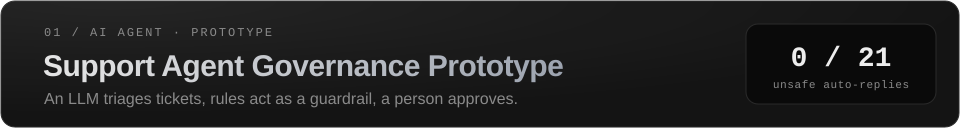](https://github.com/gustavogg99-ctrl/support-agent-governance-prototype)

An IT ticket triage agent: Claude classifies each ticket and drafts a reply, deterministic rules can only make the outcome stricter, any disagreement goes to a person, and a person approves every reply. Nothing is actually sent.

- **Result:** on 30 labelled synthetic tickets with prompt v2, 0 of 21 tickets that needed a person got an automated reply (the rules alone let 4 of 21 through). On 10 held-out prompt-injection tickets, v2 flagged all 10 as security incidents.
- **Controls:** ticket text masked before the API call, injection attempts treated as security incidents, audit log with sensitive values redacted, 149 tests in CI that never call the API.
- **Stack:** Python, Anthropic API, GitHub Actions.

**Status:** prototype on synthetic data. The limits are listed in the repository.

<p><a href="https://github.com/gustavogg99-ctrl/support-agent-governance-prototype"></a> <a href="https://github.com/gustavogg99-ctrl/support-agent-governance-prototype#results"></a></p>

<details>
<summary>See it run and how a ticket flows</summary>


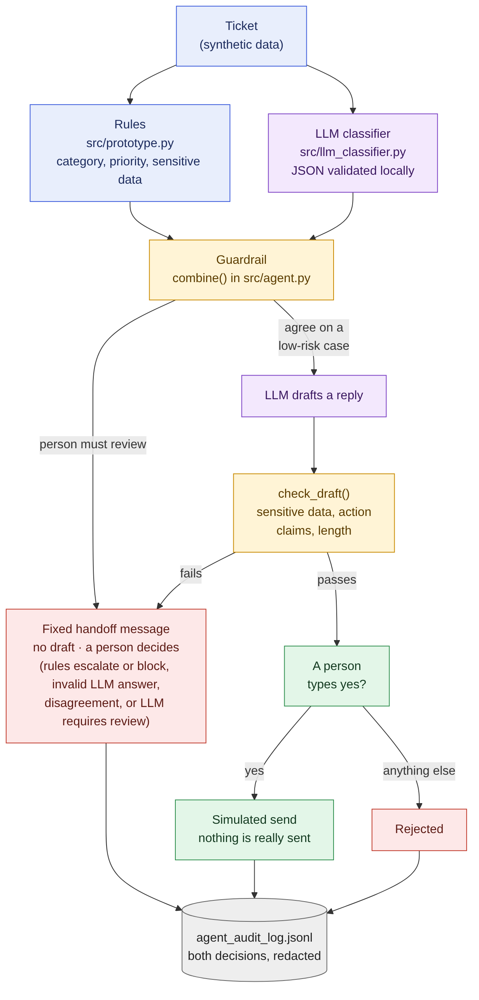

</details>

### 02 / Autoria em Forma

[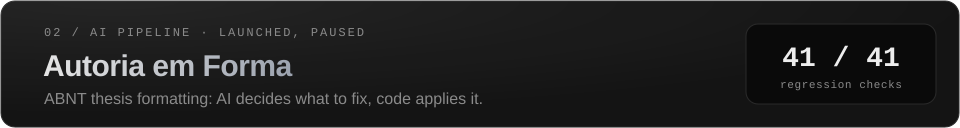](https://github.com/gustavogg99-ctrl/autoria-em-forma)

A formatting and revision service for undergraduate theses in Brazil (ABNT), built on a Python + Claude pipeline: the LLM reads the course manual and points out corrections, deterministic code applies them to the .docx, and automated checks block a delivery if anything fails.

- **Result:** 2 real jobs delivered and accepted by the clients (Oct and Nov 2026). Every delivery ships with tracked changes and comments, so the text provably remains the author's.
- **Controls:** 41 regression checks on fictional documents generated at every run; thesis text treated as data, never as instructions; macro files rejected; no client file ever in the repository (LGPD).
- **Stack:** Python, Claude, LibreOffice, Cloudflare Workers + D1.

**Status:** launched and paused after a demand test without organic traction. Code open under MIT.

<p><a href="https://github.com/gustavogg99-ctrl/autoria-em-forma"></a> <a href="https://site.autoriaemforma.workers.dev"></a></p>

<details>
<summary>See the service page</summary>

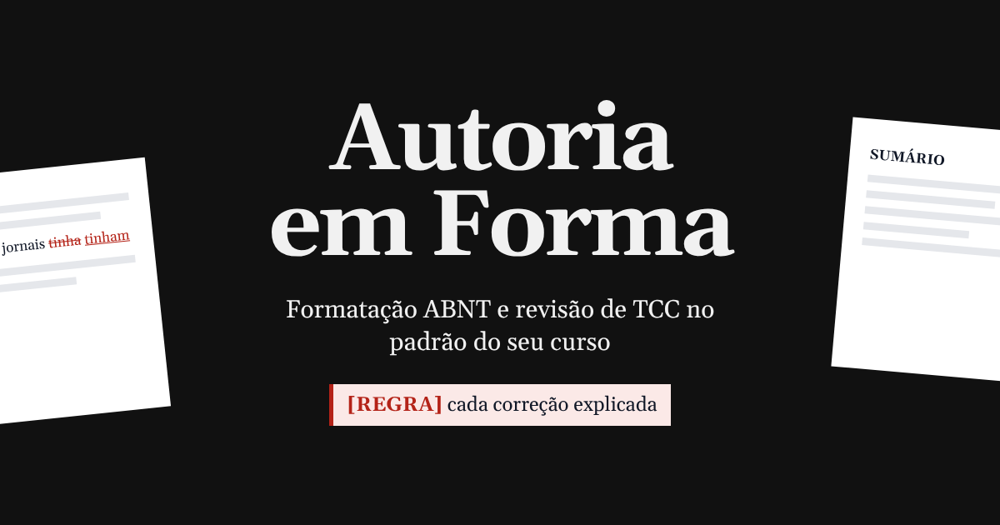

</details>

### 03 / Corporate AI Use Policy

[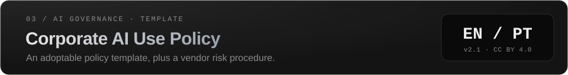](https://github.com/gustavogg99-ctrl/ethical-ai-policy)

An original, adoptable template for governing the ethical, secure and compliant use of AI, in English and Brazilian Portuguese. It targets Shadow AI: unapproved tools, personal data typed into prompts and automated decisions without human review.

- **Includes:** the policy (Markdown and PDF), an AI vendor risk assessment procedure and its matrix.
- **Aligned with:** LGPD, ISO/IEC 42001, ISO/IEC 27001, OECD AI Principles and Brazil's Bill 2,338/2023.

**Status:** template, version 2.1 (September 2026), CC BY 4.0. Version 3.0 is on the roadmap.

<p><a href="https://github.com/gustavogg99-ctrl/ethical-ai-policy/blob/main/policy/en/corporate-ai-policy-v2.1.md"></a> <a href="https://github.com/gustavogg99-ctrl/ethical-ai-policy"></a></p>

### 04 / Portfolio

[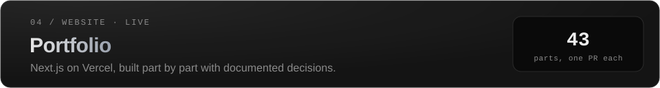](https://gustavorodrigues.vercel.app)

My bilingual portfolio (EN/PT). It was built in 43 parts, each one a branch and a pull request that must pass lint, typecheck, tests and build, with every decision recorded. Every claim on the site traces to a source, and a claims guard fails the build on banned terms.

- **Controls:** Content Security Policy and security headers, cookie-less analytics, a privacy page with legal basis and data-subject rights.
- **Stack:** Next.js, TypeScript, Tailwind CSS, Vercel.

**Status:** live.

<p><a href="https://gustavorodrigues.vercel.app"></a> <a href="https://github.com/gustavogg99-ctrl/Portfolio"></a></p>

## Tools I use

### Applied AI

<p>


</p>

**Claude (API and connectors) · OpenAI API · Microsoft Copilot · Copilot Studio · n8n · Make · Power Automate**

Agents, prompt engineering and LLM evaluation (accuracy and cost). I built WhatsApp support bots with Make and later n8n, and I develop with AI assistance.

### Engineering & tools

<p>


</p>

**Python · TypeScript · Next.js · Tailwind CSS · Vercel · Cloudflare Workers / D1 · Supabase · GitHub Actions · Git · GitHub · WhatsApp API · ServiceNow · Jira · Microsoft 365**

Regression testing and CI on every project above. ServiceNow: App Engine Studio, Flow Designer, Service Catalog and GlideAjax.

### Security & governance

<p>
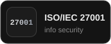
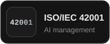


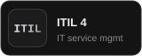
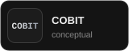

</p>

**ISO/IEC 27001 · ISO/IEC 42001 · LGPD · NIST AI RMF · ITIL 4 · COBIT (conceptual) · EU AI Act (conceptual)**

Web application security and prompt-injection defense. "Conceptual" means I know the framework, not that I am certified in it.

<details>
<summary>Where the logos come from</summary>

Logos belong to their owners and are shown only to name the tool. Sources and licenses: [docs/ICONS.md](docs/ICONS.md).

</details>

## Certifications

Microsoft AB-731 (AI Transformation Leader) · ITIL 4 Foundation · ISO/IEC 27001, ISO/IEC 20000 and ISO 9001 Associate (SkillFront)

In progress: Microsoft SC-900 (Security, Compliance, and Identity Fundamentals) and Scrum Master.

## Background

I'm finishing degrees in Systems Analysis and Development and in Journalism (expected July 2027). I co-founded MerkurIA, an AI implementation consultancy (2023–2026), and co-led a 16-person technical support team at Teledata, handling around 1,000 incidents a month.

## Now

```text
gg@governance:~ / now
├── work    → Hired by Aoop (an NTT DATA company) as ServiceNow Technical Consultant - JR. Starts December 2026.
├── study   → Microsoft SC-900 and Scrum Master
└── writing → ggblog99.wordpress.com, a public log of what I learn and build (PT/EN)
```

## Contact

Open to talk about AI products, automation and AI governance.

<p><a href="https://gustavorodrigues.vercel.app"></a> <a href="https://www.linkedin.com/in/gustavo99rodrigues/"></a> <a href="mailto:gustavohfr2003@gmail.com"></a> <a href="https://ggblog99.wordpress.com"></a></p>

`gustavohfr2003@gmail.com` · [gustavorodrigues.vercel.app](https://gustavorodrigues.vercel.app)

<p align="center">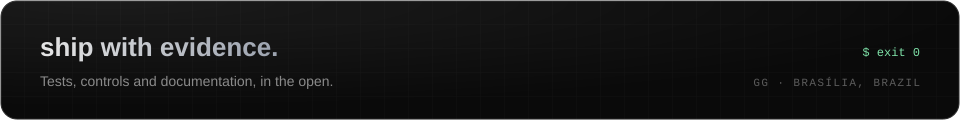</p>
