<p align="right"><a href="README.md">English</a></p>

<p align="center"><picture><source media="(max-width: 600px)" srcset="assets/hero-pt-mobile.svg" /></picture></p>

# Gustavo Rodrigues

**AI Builder · Governança de IA** · Brasília, Brasil

Construo com IA e me importo com o que acontece depois da demo: testes que barram saída ruim, controles de segurança, logs que alguém consegue auditar e limites claros do que o sistema pode fazer. Meu padrão: o LLM decide o que precisa mudar, código determinístico aplica a mudança e testes automatizados decidem se vai para produção. Governança (ISO/IEC 27001, LGPD, ISO/IEC 42001) é como torno isso confiável.

[Projetos](#projetos-selecionados) · [Ferramentas](#ferramentas-que-uso) · [Certificações](#certificações) · [Agora](#agora) · [Contato](#contato)

## Projetos selecionados

### 01 / Support Agent Governance Prototype

[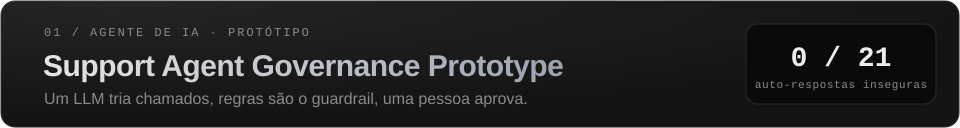](https://github.com/gustavogg99-ctrl/support-agent-governance-prototype)

Um agente de triagem de chamados de TI: o Claude classifica cada chamado e rascunha uma resposta, regras determinísticas só podem deixar o resultado mais estrito, qualquer divergência vai para uma pessoa, e uma pessoa aprova toda resposta. Nada é realmente enviado.

- **Resultado:** em 30 chamados sintéticos rotulados com o prompt v2, 0 de 21 chamados que exigiam uma pessoa receberam resposta automática (só com as regras, 4 de 21 passavam). Em 10 chamados de prompt injection reservados para teste, o v2 sinalizou os 10 como incidentes de segurança.
- **Controles:** texto do chamado mascarado antes da chamada à API, tentativas de injection tratadas como incidentes de segurança, log de auditoria com valores sensíveis ocultados, 149 testes no CI que nunca chamam a API.
- **Stack:** Python, API da Anthropic, GitHub Actions.

**Status:** protótipo com dados sintéticos. Os limites estão listados no repositório.

<p><a href="https://github.com/gustavogg99-ctrl/support-agent-governance-prototype"></a> <a href="https://github.com/gustavogg99-ctrl/support-agent-governance-prototype#results"></a></p>

<details>
<summary>Veja rodando e como um chamado flui</summary>


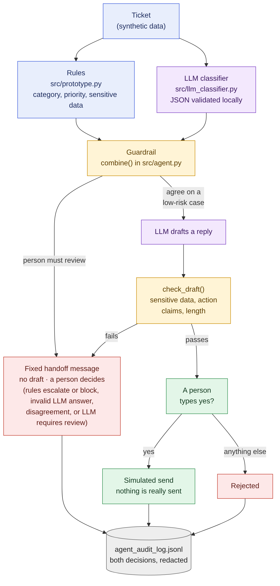

</details>

### 02 / Autoria em Forma

[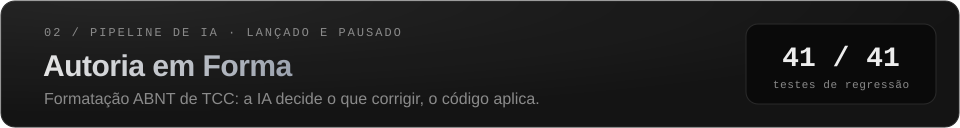](https://github.com/gustavogg99-ctrl/autoria-em-forma)

Um serviço de formatação e revisão de TCC de graduação no Brasil (ABNT), construído sobre um pipeline Python + Claude: o LLM lê o manual do curso e aponta correções, código determinístico as aplica no .docx, e verificações automatizadas barram a entrega se algo falhar.

- **Resultado:** 2 trabalhos reais entregues e aceitos pelos clientes (out e nov de 2026). Toda entrega vai com alterações controladas e comentários, então o texto continua comprovadamente do autor.
- **Controles:** 41 testes de regressão em documentos fictícios gerados a cada execução; texto do TCC tratado como dado, nunca como instrução; arquivos com macro rejeitados; nenhum arquivo de cliente no repositório (LGPD).
- **Stack:** Python, Claude, LibreOffice, Cloudflare Workers + D1.

**Status:** lançado e pausado após um teste de demanda sem tração orgânica. Código aberto sob MIT.

<p><a href="https://github.com/gustavogg99-ctrl/autoria-em-forma"></a> <a href="https://site.autoriaemforma.workers.dev"></a></p>

<details>
<summary>Veja a página do serviço</summary>

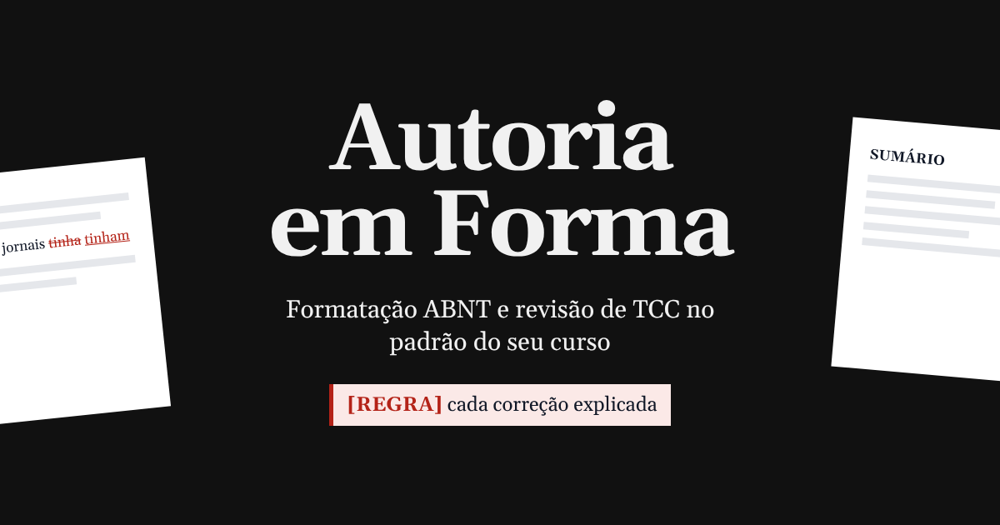

</details>

### 03 / Política Corporativa de Uso de IA

[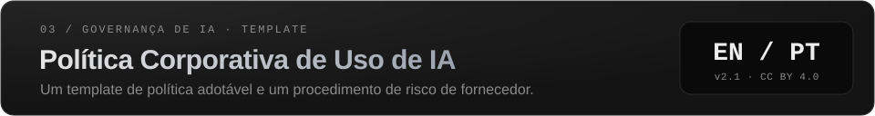](https://github.com/gustavogg99-ctrl/ethical-ai-policy)

Um template original e adotável para governar o uso ético, seguro e em conformidade de IA, em inglês e português do Brasil. Mira a Shadow AI: ferramentas não aprovadas, dados pessoais digitados em prompts e decisões automatizadas sem revisão humana.

- **Inclui:** a política (Markdown e PDF), um procedimento de avaliação de risco de fornecedores de IA e sua matriz.
- **Alinhada a:** LGPD, ISO/IEC 42001, ISO/IEC 27001, Princípios de IA da OCDE e o Projeto de Lei 2.338/2023.

**Status:** template, versão 2.1 (setembro de 2026), CC BY 4.0. A versão 3.0 está no roadmap.

<p><a href="https://github.com/gustavogg99-ctrl/ethical-ai-policy/blob/main/policy/pt-br/politica-corporativa-ia-v2.1.md"></a> <a href="https://github.com/gustavogg99-ctrl/ethical-ai-policy"></a></p>

### 04 / Portfolio

[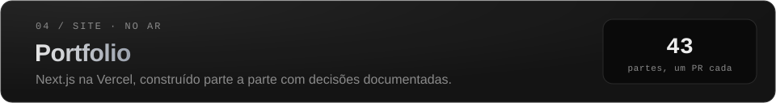](https://gustavorodrigues.vercel.app)

Meu portfólio bilíngue (EN/PT). Foi construído em 38 partes, cada uma uma branch e um pull request que precisa passar em lint, typecheck, testes e build, com toda decisão registrada. Cada afirmação do site remete a uma fonte, e uma trava de afirmações derruba o build se aparecer um termo proibido.

- **Controles:** Content Security Policy e headers de segurança, analytics sem cookies, uma página de privacidade com base legal e direitos do titular.
- **Stack:** Next.js, TypeScript, Tailwind CSS, Vercel.

**Status:** no ar.

<p><a href="https://gustavorodrigues.vercel.app"></a> <a href="https://github.com/gustavogg99-ctrl/Portfolio"></a></p>

## Ferramentas que uso

### IA aplicada

<p>

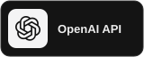


</p>

**Claude (API e conectores) · OpenAI API · Microsoft Copilot · Copilot Studio · n8n · Make · Power Automate**

Agentes, engenharia de prompts e avaliação de LLMs (acurácia e custo). Construí bots de atendimento no WhatsApp com Make e depois n8n, e desenvolvo com apoio de IA.

### Engenharia e ferramentas

<p>


</p>

**Python · TypeScript · Next.js · Tailwind CSS · Vercel · Cloudflare Workers / D1 · Supabase · SQL · GitHub Actions · Git · GitHub · API do WhatsApp · ServiceNow · Jira · Microsoft 365**

Testes de regressão e CI em todos os projetos acima. ServiceNow: App Engine Studio, Flow Designer, Service Catalog e GlideAjax.

### Segurança e governança

<p>
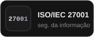
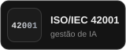

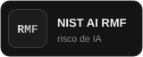
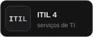
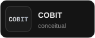

</p>

**ISO/IEC 27001 · ISO/IEC 42001 · LGPD · NIST AI RMF · ITIL 4 · COBIT (conceitual) · EU AI Act (conceitual)**

Segurança de aplicações web e defesa contra prompt injection. "Conceitual" significa que conheço o framework, não que sou certificado nele.

<details>
<summary>De onde vêm os logos</summary>

Os logos pertencem aos seus donos e aparecem só para nomear a ferramenta. Fontes e licenças: [docs/ICONS.md](docs/ICONS.md).

</details>

## Certificações

Microsoft AB-731 (AI Transformation Leader) · ITIL 4 Foundation · ISO/IEC 27001, ISO/IEC 20000 e ISO 9001 Associate (SkillFront)

Em andamento: Microsoft SC-900 (Security, Compliance, and Identity Fundamentals) e Scrum Master.

## Formação

Estou concluindo as graduações em Análise e Desenvolvimento de Sistemas e em Jornalismo (previsão: julho de 2027). Cofundei a MerkurIA, consultoria de implementação de IA (2023–2026), e co-liderei uma equipe de suporte técnico de 16 pessoas na Teledata, atendendo cerca de 1.000 incidentes por mês.

## Agora

```text
gg@governance:~ / agora
├── trabalho → Contratado pela Aoop (empresa NTT DATA) como ServiceNow Technical Consultant - JR. Começo em dezembro de 2026.
├── estudo   → Microsoft SC-900 e Scrum Master
└── escrita  → ggblog99.wordpress.com, um diário público do que aprendo e construo (PT/EN)
```

## Contato

Aberto a conversar sobre produtos de IA, automação e governança de IA.

<p><a href="https://gustavorodrigues.vercel.app"></a> <a href="https://www.linkedin.com/in/gustavo99rodrigues/"></a> <a href="mailto:gustavohfr2003@gmail.com"></a> <a href="https://ggblog99.wordpress.com"></a></p>

`gustavohfr2003@gmail.com` · [gustavorodrigues.vercel.app](https://gustavorodrigues.vercel.app)

<p align="center">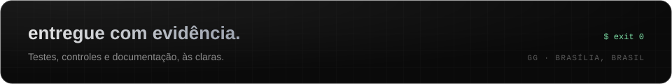</p>
